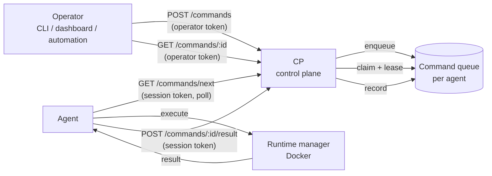
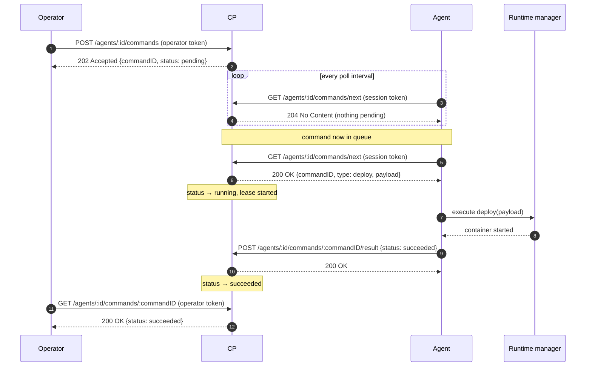
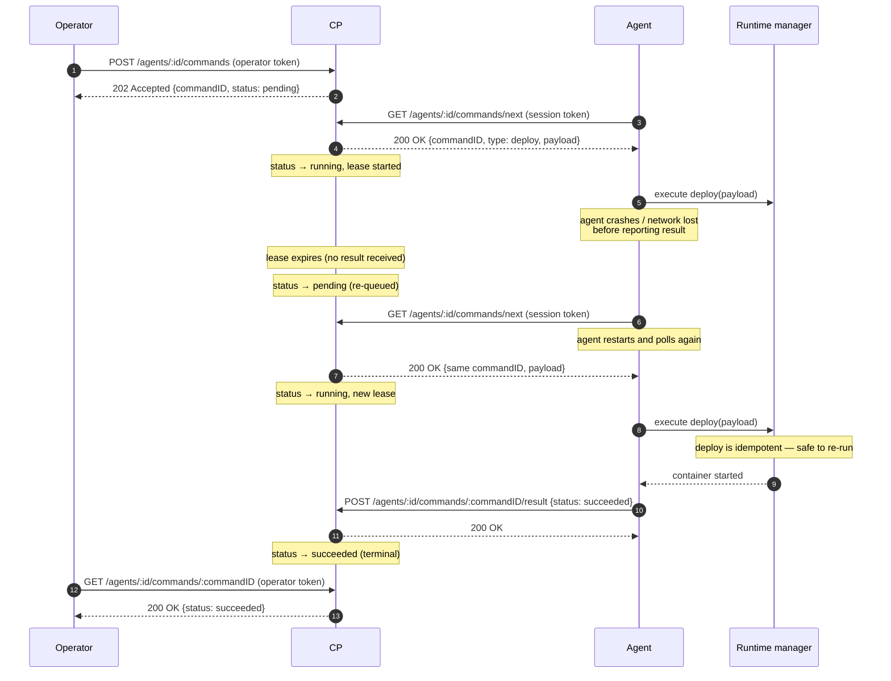

# Remote Deploy Path

> Design note for issue #12: how the control plane sends deployment commands to
> an agent that runs on someone else's machine, and what the thin vertical
> slice in this branch implements.

## Summary

- The **agent always dials out** to the control plane (CP). The CP never opens a
  connection to an agent, so agents keep working behind NAT, firewalls and
  corporate proxies with no inbound ports.
- The **queue (pull) model** is used for the first slice: the agent polls the CP
  for commands, executes them and reports the outcome. Long-polling is a
  drop-in upgrade of the same endpoint, and a persistent stream is the eventual
  target. The reasoning is in [Queue vs push](#queue-vs-push).
- Two credential classes protect the channel: an **agent session token**
  (agent → CP, per agent) and an **operator token** (operator → CP). Both are
  bearer tokens and both require TLS in front of the CP.
- The agent's **local HTTP API stays loopback-only**. The remote path is a
  separate, authenticated channel; the deployment ingress on the host is not
  exposed and its security is not relaxed.

## What this branch implements

The thin vertical slice, end to end:

- Control plane: an in-memory command queue with enqueue, list, read, claim
  and result endpoints, plus the two credential classes described below.
- Agent: a command loop that polls the control plane, executes `deploy`,
  `stop` and `remove` commands against the runtime manager and reports the
  outcome.
- Tests on both sides and an end-to-end smoke test in
  `apps/control-plane/test-api.sh`.

Not in this slice: the CLI half of remote deploy (`nova deploy --server …`),
long-polling, persistent queues and multi-user control plane accounts. They are
listed in [Follow-ups](#follow-ups).

## Context

Today a deploy is a local operation:

```
nova deploy → agent local API (127.0.0.1, bearer token) → runtime manager → Docker
```

The CLI can only reach an agent on the same machine, because the agent API
refuses to bind to a non-loopback address and requires a bearer token on every
request. That is deliberate: the agent API is a deployment ingress on a machine
the user owns, and exposing it to the network would hand anyone who reaches
the port the ability to run containers on that host.

The goal of this issue is to make `nova deploy` work against a machine that is
not the developer's laptop: the CP must be able to tell a remote agent to
deploy a service, and the agent must do it on the operator's behalf.

## Constraints

| Constraint | Consequence |
| --- | --- |
| Agents sit behind NAT/firewalls | The CP cannot dial the agent; the agent must poll. |
| The agent owns the host | The agent must not accept commands for another agent, and commands must be attributable to a single agent. |
| The local API is a host-level ingress | It stays loopback-only and token-protected. The command channel is a different path. |
| Deploys are privileged (root-equivalent on the host) | The channel needs strong authentication, replay protection and auditability. |
| The CP is currently stateless and single-instance | The command queue must not require a connection registry to work. |

## Queue vs push

| | **Queue (agent polls)** | **Push (CP dials agent)** |
| --- | --- | --- |
| Connectivity | Agent dials out; works everywhere | Needs inbound access (port-forward, tunnel, public IP) |
| CP state | Stateless; commands live in a queue | Connection registry; CP must track live agents |
| Latency | Bounded by the poll interval | Immediate |
| Failure mode | Command waits in the queue | Command is lost if the CP cannot reach the agent |
| Multi-instance CP | Trivial (any instance can serve the queue) | Needs sticky routing or shared state |
| Resource cost | One short request per agent per interval | One long-lived connection per agent |

**Decision: queue.** Deploy latency of a few seconds is irrelevant next to the
operational cost of pushing: push would require every agent host to expose a
port or run a tunnel, and would make the CP stateful. The CP would also have to
decide what to do with a command for an agent that cannot be reached.

**Evolution path.** The slice implements a plain poll. The next step is
**long-polling**: the agent holds the request open and the CP answers as soon as
a command is enqueued. That keeps pull semantics (no inbound connectivity, no
connection registry) while removing most of the latency. The last step, if the
CP becomes multi-instance, is a **persistent stream** (WebSocket or gRPC)
carrying both commands and log output.

The endpoint shape does not change between these steps: long-polling adds a
`wait` query parameter, and a stream replaces the poll loop with a reader
goroutine.

## Command lifecycle

```
operator ──enqueue──▶ CP queue ──poll──▶ agent ──execute──▶ runtime manager
                              ▲                                   │
                              └───────────result───────────────────┘
```

1. An operator (CLI, dashboard, automation) posts a command to the CP for a
   specific agent.
2. The CP validates it, stores it in the queue for that agent and returns
   `202 Accepted` with the command ID.
3. The agent polls `GET .../commands/next`. The CP hands out the oldest
   pending command for that agent and marks it `running` with a lease.
4. The agent executes the command against the runtime manager and posts the
   result (`succeeded` / `failed`).
5. The CP records the result. Operators can read the command status.

Delivery is **at-least-once**: if the agent dies after taking a command but
before reporting, the lease expires and the command is handed out again.
Commands are therefore required to be idempotent (`deploy`, `stop` and `remove`
all are, at the service level).

Commands carry an optional expiry. An expired command is not executed; the CP
marks it `failed` with an `expired` reason.

The queue is bounded: an agent keeps at most 32 command records. Finished
commands are pruned when new ones arrive, and a full queue is reported back to
the operator as `429` instead of growing without bound.

### Architecture overview



The agent always dials out to the CP. The CP never opens a connection to the
agent, so the agent keeps working behind NAT and firewalls with no inbound
ports required.

### Happy path — sequence diagram



### Failure path — agent dies after claim, lease expires, re-delivery



**Key properties shown above:**

- **At-least-once delivery** — the lease timeout causes re-delivery if the
  agent dies between claim and result.
- **Idempotency** — `deploy`, `stop`, and `remove` are safe to re-run; the
  runtime manager tolerates duplicate commands at the service level.
- **Same command ID** — the re-delivered command keeps its original ID, so a
  duplicate execution is visible in the audit trail.
- **Terminal once succeeded** — a command that has already reached `succeeded`
  or `failed` will not be handed out again even if a duplicate result arrives.

## API

Operator-facing (requires the operator token):

| Method | Path | Purpose |
| --- | --- | --- |
| `POST` | `/api/v1/agents/:agentID/commands` | Enqueue a command (`202` + command record) |
| `GET` | `/api/v1/agents/:agentID/commands` | List an agent's commands and their status |
| `GET` | `/api/v1/agents/:agentID/commands/:commandID` | Read one command record |

Agent-facing (requires the agent's session token):

| Method | Path | Purpose |
| --- | --- | --- |
| `GET` | `/api/v1/agents/:agentID/commands/next` | Claim the next command (`204` when idle) |
| `POST` | `/api/v1/agents/:agentID/commands/:commandID/result` | Report the outcome |

The agent can only ever see its own commands: the CP compares the bearer token
in the request with the session token issued to the agent named in the path, so
a token issued to agent A cannot read or complete agent B's commands.

## Authentication and authorization

**Agent → CP: session token.** At registration the CP issues a random 256-bit
session token and returns it to the agent. Every agent-scoped request must
present it as `Authorization: Bearer <session_token>`. The comparison is done in
constant time. The token is bound to one agent ID, which is what makes the
"claim the next command" endpoint safe to expose.

The same credential model is being rolled out for the remaining agent endpoints
(heartbeat, agent details) in issue #6. The command channel implements its own
small copy of that check so it does not depend on that work landing first;
once the shared middleware exists, the copy should be replaced by it.

**Operator → CP: operator token.** The CP reads `CONTROL_PLANE_ADMIN_TOKEN` from
the environment. If it is not set, the command API is disabled and the
enqueue/list endpoints answer `503`. This fails closed: an unauthenticated
control plane can never enqueue a deployment. The token is compared in constant
time.

**TLS.** Both credentials are bearer tokens: they are as sensitive as a
password. The CP must be served over TLS (directly or behind a terminating
proxy) whenever it is reachable from a network. *TODO: make the agent refuse
plaintext HTTP for a non-loopback CP URL, mirroring the CLI's `checkTransport`
helper, which already refuses to send a credential over plaintext HTTP to a
non-loopback host.*

**Why not reuse the agent's local API token?** The local API token is a
host-level credential: it grants full control of the host's containers to
whoever holds it, and it is intentionally scoped to loopback. Reusing it for
the network-facing channel would widen its blast radius and couple two very
different trust domains.

## Threat model

Assets: the host the agent runs on, the deployed services and their
configuration/secrets, the agent session token, and the integrity of the command
channel.

| Threat | Mitigation |
| --- | --- |
| Someone on the network enqueues a deployment | The enqueue endpoint requires the operator token; the endpoint is disabled when no token is configured |
| A stolen agent session token is used to impersonate another agent | The token is bound to one agent ID and checked against the agent named in the path |
| Command tampering in transit | TLS is required for the CP hop. The agent refusing plaintext for a non-loopback CP is a follow-up |
| Command replay | Command IDs are unique, a command is leased to one agent at a time and its terminal state is recorded; a re-delivered command keeps its ID, so a duplicate execution is visible |
| A compromised CP asks for a dangerous container | **Known gap.** The agent currently trusts the payload it receives. Follow-up: an agent-side policy allowlist (no privileged mode, no host mounts, no host network) — see [Follow-ups](#follow-ups) |
| A hostile or buggy operator floods the queue | The queue depth per agent is capped and commands can expire |
| An agent executes commands for another agent | The CP routes by agent ID and validates the token; the agent only ever polls its own path |
| A remote attacker reaches the agent's deployment ingress | The local API is unchanged: loopback bind enforced at startup, bearer token on every request. The command channel never proxies to it |
| An agent is compromised and starts deploying on its own | Out of scope for the channel; the CP cannot prevent an agent from using its own Docker socket |
| Someone reads the agent registry | **Known gap.** `GET /api/v1/agents` is still unauthenticated on the control plane. Issue #6 covers the agent endpoints |

Deliberately out of scope: user accounts, multi-tenancy and per-user
authorization. The control plane currently has a single operator credential;
per-user identities are a follow-up (see [Follow-ups](#follow-ups)).

## Payload contract

The payload is opaque JSON to the CP; the agent owns the schema.

`deploy` payload — the agent's `ServiceSpec` (snake_case keys):

```json
{
  "name": "my-api",
  "image": "nginx:latest",
  "version": "1.0.0",
  "replicas": 1,
  "ports": { "8080": "80" },
  "env": ["KEY=value"],
  "restart_policy": "unless-stopped",
  "health_check": { "type": "http", "path": "/health", "port": 80 }
}
```

`stop` and `remove` payload:

```json
{ "name": "my-api" }
```

The CP performs a minimal sanity check on `deploy` payloads (a non-empty `name`
and `image`) so obviously broken commands are rejected at enqueue time rather
than on the host.

## Follow-ups

- Agent-side policy allowlist for payloads (no privileged containers, no host
  mounts/network), enforced independently of the CP.
- Long-polling (`?wait=30`) to cut deploy latency, then a persistent stream
  when the CP runs multiple instances.
- Per-user authentication for the control plane API, replacing the single
  operator token.
- Short-lived, rotating agent credentials (or mTLS) instead of a long-lived
  session token; storing only a hash of the token on the CP side.
- Persisting the command queue (the agent registry is being moved to SQLite in
  issue #7; the queue should follow) so commands survive a CP restart.
- The CLI gaining a `--server`/`--agent` mode that talks to the CP instead of
  the local agent, which is the user-visible half of "remote deploy".
